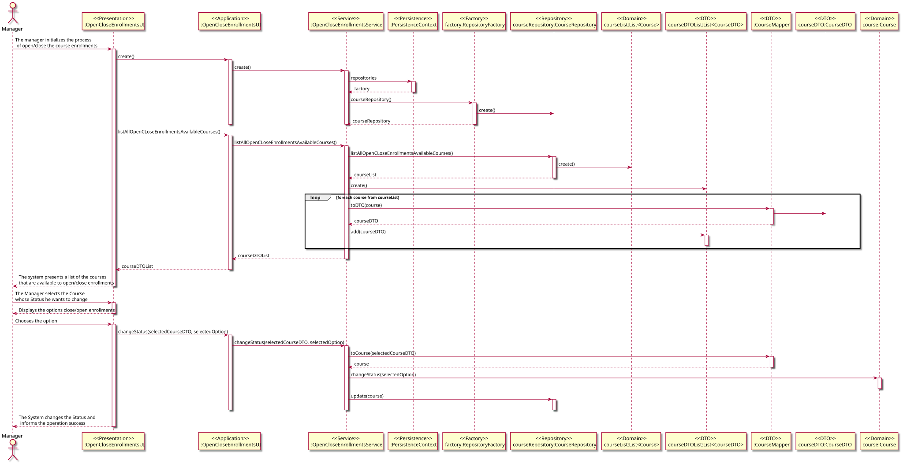

US1003: As Manager, I want to open and close enrollments in courses. 
=======================================

# 1. Context #
**US1003**: In this US the status of a given course will be updated to either state enroll or state in progress, that is relevant to **US1006** and **US1008**.

# 2 - Requirements #
**1. Acceptance Criteria**
- The course status changes must be persisted.

**2. Pre conditions**
- The course must be created.
- The previous course status versus the new one must be valid in terms of the life cycle flow.

**3.Main scenario**
1. Manager selects the option to open and close enrollments in courses.
2. System shows the available courses.
3. Manager selects the course where he wants to change the status.
4. System requests if he wants to open or close enrollments in the selected course.
5. Manager chooses an option.
6. System validates the requested operation and shows the result.

**4. Alternative Flow**

# 2 - Analysis #
**1. Actor:** Manager.

**3.Client Clarifications**
- No clarification were given regarding this US so far.

**Interested actors**
- Manager : wants to change the course status.
- Student : wants to list all courses that are available to him.

**Related US**
- US1002: There must be courses created.
- US1006: The status of a course can reflect on which courses are listed.
- US1008: A Student can only request to enroll on a course with state enroll status.

**4.Relevant business aspects**
* The state enroll status represent an open course with open enrollments.
* The state in progress status represent an open course with closed enrollments.
* The referred status are an integral part of the course life cycle that dictates specific business rules.

# 3. Design

## 3.1. System Diagram

# 4. Tests