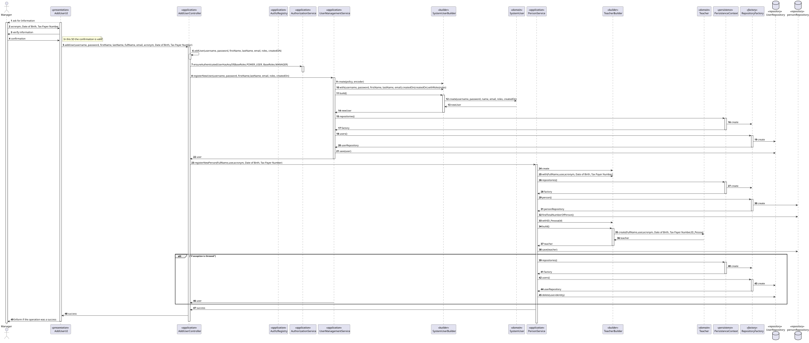
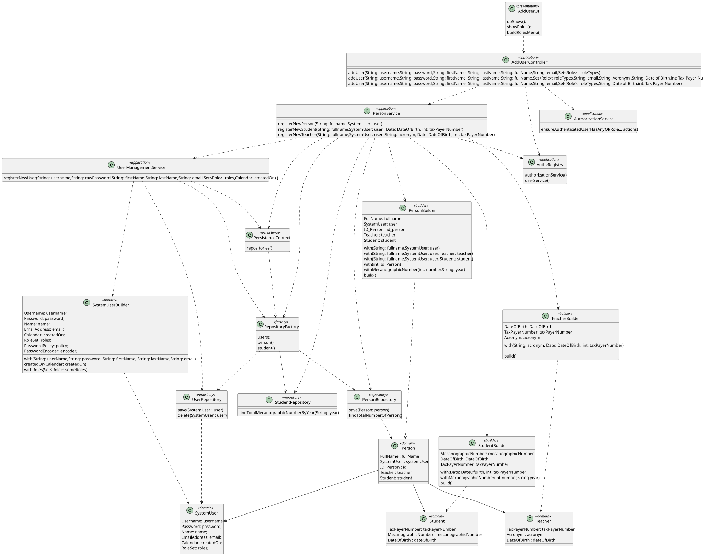

# US 1001 -  As Manager, I want to be able to register, disable/enable, and list users of the system (Teachers and Students, as well as Managers)

## 1. Context

In this US the manager wants to be able to register, disable/enable, and list users of the system
## 2. Requirements

**Main actor**

* Manager

**Requirement**
FRU01 - Management of Users Create, disable/enable, and list users of the system
(Teachers and Students, as well as Managers)


## 3. Analysis

We will start to see how its created an user in the Base app given by eapli.
Afterwards we will adapt it to be able to respond to your necessities for that we will also need to create the classes Teacher and Student as well as Person

### 3.1 Register users
**Main scenario**
1. Manager selects option to register a user
2. System asks for the base information (Username, Password,firstName,lastName,Full Name,Email)
3. Manager inserts the data
4. System shows list of roles
5. Manager selects roles
6. System if the role is student or teacher ask for more information
7. Manager introduces
8. System ask if the information is correct
9. Manager validates
10. System creates User
11. System display user info


**Other scenarios**

**4.a.** The system can´t create the user 
1. The system notifies that this problem has occurred

**5.a.** The Manager doesn´t validate information
1. The use case terminates


### Client Question 
#### Question
Good afternoon,
Is there any format rule regarding the acronym for the teacher length-wise or which characters should or should not be used? Also, should this acronym be unique for each teacher?
Regards,
Group 13.
#### Solution
Hello.
I think a sequence of capitalised words should be used for the teacher acronym. Maybe the length could be a configuration setting of the application.
I think it would be wise to enforce that acronyms be unique.
Regards.


### 3.2 Enable/Disable users

### 3.3 List users of the system

## 4. Design

### Register User

### 4.1. Rational


|                Main Scenario                 |                 Question: Which class...                  |                            Answer                             |                                                              Pattern                                                               |
|:--------------------------------------------:|:---------------------------------------------------------:|:-------------------------------------------------------------:|:----------------------------------------------------------------------------------------------------------------------------------:|
| 1. Manager selects option to register a user |                ...interacts with the user                 |                           AddUserUI                           |                                                          Pure Fabrication                                                          |
|                                              |                ...coordinates the use case                |                       AddUserController                       |                                                             Controller                                                             |
|                                              |            ...interacts with the domain layer             |              UserManagementService\PersonService              |             Controller-service - hides the complexity of the use case from the controller class, lowering its coupling             |
|  2. System asks for the User creation data   |                                                           |                                                               |                                                                                                                                    |
|         3. Manager inserts the data          |                ...stores the inserted data                |                   SystemUser\Person\Teacher                   |                                         Information Expert - the class knows its own data                                          |
|                                              |                  ... creates the object                   | SystemUserBuilder\PersonBuilder\TeacherBuilder\StudentBuilder |                            Builder - Interface that allows the creation of an instance of a given class                            |
|     4. System persists the created User      | ...creates the instance responsible for persisting Course |                       RepositoryFactory                       | Abstract Factory - Interface responsible for creating a Factory of related Objects without explicitly specifying the intend Class; |
|                                              |              ...persists the created object               |                UserRepository\PersonRepository                |            Repository -  hide the details of persisting and reconstructing an object while keeping the domain language             |

### 4.2 Sequence Diagram




### 4.3 Class Diagram




### 4.4. Tests

**Test 1:** *Verifies that it is not possible to create an instance of the Person class with null values.*

```
@Test(expected = IllegalArgumentException.class)
public void ensureNullIsNotAllowed() {
	Person person = new Person(null, null);
}
```

**Test 2:** *Verifies that it is not possible to create a TaxPayerNumber with a number that doesn't have the lenght of 9 digits.*

```
@Test(expected = IllegalArgumentException.class)
public void ensureTaxPayerNumberIsValid() {
	TaxPayerNumber numb = new TaxPayerNumber(12345678);
}
```

**Test 3:** *Verifies that it is not possible to create a DateOfBirth with a date from the Future.*

```
@Test(expected = IllegalArgumentException.class)
        public void ensureDateOfBirthCanNotBeInTheFuture() {
        DateOfBirth test =  new DateOfBirth(new Date(1000,10,2));
}
```

## 5. Implementation

*In this section the team should present, if necessary, some evidencies that the implementation is according to the design. It should also describe and explain other important artifacts necessary to fully understand the implementation like, for instance, configuration files.*

*It is also a best practice to include a listing (with a brief summary) of the major commits regarding this requirement.*

## 6. Integration/Demonstration

*In this section the team should describe the efforts realized in order to integrate this functionality with the other parts/components of the system*

*It is also important to explain any scripts or instructions required to execute an demonstrate this functionality*

## 7. Observations

*This section should be used to include any content that does not fit any of the previous sections.*

*The team should present here, for instance, a critical prespective on the developed work including the analysis of alternative solutioons or related works*

*The team should include in this section statements/references regarding third party works that were used in the development this work.*