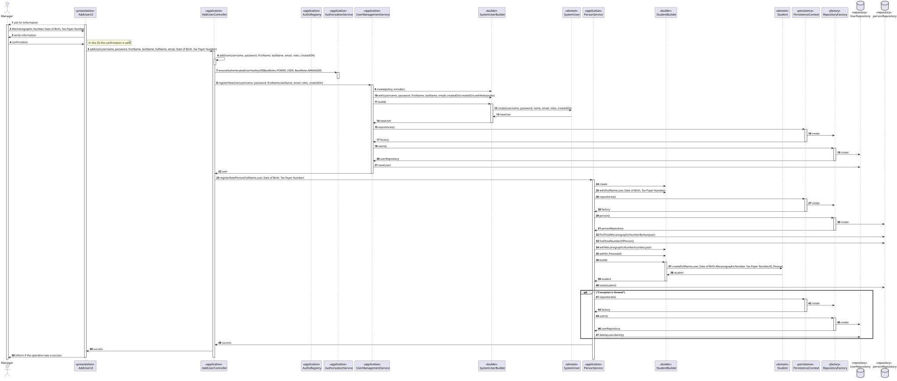

# US 1001 -  As Manager, I want to be able to register, disable/enable, and list users of the system (Teachers and Students, as well as Managers)

## 1. Context

In this US the manager wants to be able to register, disable/enable, and list users of the system
## 2. Requirements

**Main actor**

* Manager

**Requirement**
FRU01 - Management of Users Create, disable/enable, and list users of the system
(Teachers and Students, as well as Managers)


## 3. Analysis

We will start to see how its created an user in the Base app given by eapli.
Afterwards we will adapt it to be able to respond to your necessities for that we will also need to create the classes Teacher and Student as well as Person

### 3.1 Register users
**Main scenario**
1. Manager selects option to register a user
2. System asks for the base information (Username, Password,firstName,lastName,Full Name,Email)
3. Manager inserts the data
4. System shows list of roles
5. Manager selects roles
6. System if the role is student or teacher ask for more information
7. Manager introduces
8. System ask if the information is correct
9. Manager validates
10. System creates User
11. System display user info


**Other scenarios**

**4.a.** The system can´t create the user 
1. The system notifies that this problem has occurred

**5.a.** The Manager doesn´t validate information
1. The use case terminates

### 3.2 Enable/Disable users

### 3.3 List users of the system

## 4. Design


## 4.1 SD

### Register User





### 4.2. Class Diagram


### 4.3. Applied Patterns

### 4.4. Tests

**Test 1:** *Verifies that it is not possible to create an instance of the Example class with null values.*

```
@Test(expected = IllegalArgumentException.class)
public void ensureNullIsNotAllowed() {
	Example instance = new Example(null, null);
}
````

## 5. Implementation

*In this section the team should present, if necessary, some evidencies that the implementation is according to the design. It should also describe and explain other important artifacts necessary to fully understand the implementation like, for instance, configuration files.*

*It is also a best practice to include a listing (with a brief summary) of the major commits regarding this requirement.*

## 6. Integration/Demonstration

*In this section the team should describe the efforts realized in order to integrate this functionality with the other parts/components of the system*

*It is also important to explain any scripts or instructions required to execute an demonstrate this functionality*

## 7. Observations

*This section should be used to include any content that does not fit any of the previous sections.*

*The team should present here, for instance, a critical prespective on the developed work including the analysis of alternative solutioons or related works*

*The team should include in this section statements/references regarding third party works that were used in the development this work.*