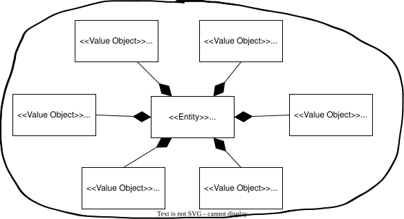

# US 1002 - As Manager, I want to create courses


## 1. Context

It is the first time the task is assigned to be developed.
This User story will allow us to create courses which will let us do many other US's as a lot of them are related to courses.

## 2. Requirements

**Main actor**

* Manager

**Interested actors (and why)**

* Manager : wants to create, change status, bulk enroll students, set teachers of a specific course
* Student : wants to request enrollment in a course
* Teacher : wants to schedule classes/extra-classes and create exams for a specific course 

**Pre conditions**

* N/A

**Post conditions**

* The created course should be registered and persisted in the system

**Main scenario**
1. Manager selects option to create a course
2. System asks for the course creation data (name, title, description, identifier and enrollment limits)
3. Manger inserts the data
4. System validates inserted data and shows it, asking for confirmation
5. Manger confirms
6. System persists the created course

**Other scenarios**

**4.a.** The system verifies that a course with the inserted identifier already exists in the system  
1. The system notifies that this problem has occurred
2. System asks again for the course creation data (back to step 2)

**5.a.** The Manager doesn´t confirm
1. The use case terminates


**Special requirements**

N/A

## 3. Analysis

Relevant DM excerpt



## 4. Design

*In this sections, the team should present the solution design that was adopted to solve the requirement. This should include, at least, a diagram of the realization of the functionality (e.g., sequence diagram), a class diagram (presenting the classes that support the functionality), the identification and rational behind the applied design patterns and the specification of the main tests used to validade the functionality.*

### 4.1. Realization

### 4.2. Class Diagram


### 4.3. Applied Patterns

### 4.4. Tests

**Test 1:** *Verifies that it is not possible to create an instance of the Example class with null values.*

```
@Test(expected = IllegalArgumentException.class)
public void ensureNullIsNotAllowed() {
	Example instance = new Example(null, null);
}
````

## 5. Implementation

*In this section the team should present, if necessary, some evidencies that the implementation is according to the design. It should also describe and explain other important artifacts necessary to fully understand the implementation like, for instance, configuration files.*

*It is also a best practice to include a listing (with a brief summary) of the major commits regarding this requirement.*

## 6. Integration/Demonstration

*In this section the team should describe the efforts realized in order to integrate this functionality with the other parts/components of the system*

*It is also important to explain any scripts or instructions required to execute an demonstrate this functionality*

## 7. Observations

*This section should be used to include any content that does not fit any of the previous sections.*

*The team should present here, for instance, a critical prespective on the developed work including the analysis of alternative solutioons or related works*

*The team should include in this section statements/references regarding third party works that were used in the development this work.*