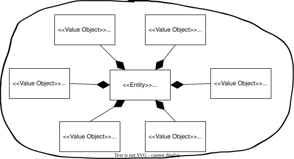
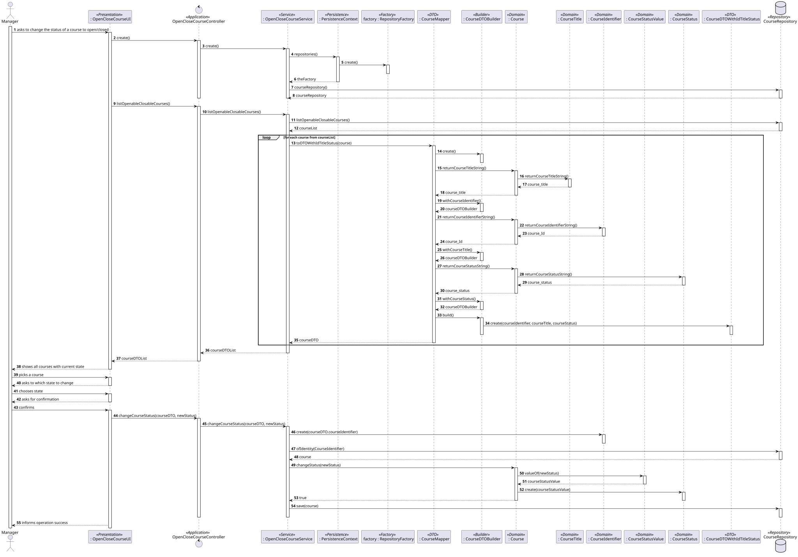

# US 1004 - As Manager, I want to open and close courses

## 1. Context

It is the first time the task is assigned to be developed.
This US will allow us to change the status of the courses to open or closed.

## 2. Requirements

**Main actor**

* Manager

**Interested actors (and why)**

* Manager: wants to open/close courses

**Preconditions**

* There needs to be at least one course in the system
* The status of the course needs to be closed or in progress

**Postconditions**

* The status of the course needs to be persisted in the system

**Main scenario**
1. Manager asks to change the status of a course to open/closed;
2. System shows all courses that can be opened/closed;
3. Manger picks a course;
4. System shows its state and asks if it still wants to change it
5. Manger confirms
6. System persists the new status of course and informs to Manager that the operation was completed with success

**Other scenarios**

**a.** The system doesn't have any possible courses that can be opened/closed
1. Manager asks to change the status of a course to open/closed
2. System informs that there are no courses available to open or close

**b.** The Manager doesn't confirm the operation
1. Manager asks to change the status of a course to open/closed
2. System shows all courses that can be opened/closed
3. Manger picks course
4. System shows its state and asks if it still wants to change it
5. Manager doesn't confirm
6. System informs that the operation was aborted

**Special requirements**

N/A

## 3. Analysis

Relevant DM excerpt



## 4. Design

*In this sections, the team should present the solution design that was adopted to solve the requirement. This should include, at least, a diagram of the realization of the functionality (e.g., sequence diagram), a class diagram (presenting the classes that support the functionality), the identification and rational behind the applied design patterns and the specification of the main tests used to validade the functionality.*

### 4.1 Rationale

|                                                  Main Scenario                                                   |                                                                                                                                                        Question: which class...                                                                                                                                                        |                                                                         Answer                                                                          | Pattern (with justification)                                                                                                                                                                                                                                                                                                                |
|:----------------------------------------------------------------------------------------------------------------:|:--------------------------------------------------------------------------------------------------------------------------------------------------------------------------------------------------------------------------------------------------------------------------------------------------------------------------------------:|:-------------------------------------------------------------------------------------------------------------------------------------------------------:|---------------------------------------------------------------------------------------------------------------------------------------------------------------------------------------------------------------------------------------------------------------------------------------------------------------------------------------------|
|                         1. Manager asks to change the status of a course to open/closed                          |                                                                                                   <p>A. Interacts with the Manager?</p><p>B. Coordinates the Use Case?</p> <p>C. Interacts with the Domain and Persistence Layer</p>                                                                                                   |                            <p> A. OpenCloseCourseUI</p><p> B. OpenCloseCourseController</p><p>C. OpenCloseCourseService </p>                            | <p> A. Pure Fabrication - Class that doesn't exist in the domain but is necessary for the functionality of the system </p> <p> B. Controller - Responsible for handling system events  </p><p> C. Controller-Service - Class responsible for handling the domain layer and the persistence layer according with the controller requests</p> |
|                              2. System shows all courses that can be opened/closed                               | <p>A. Knows which courses can be closed/opened? </p>  <p> B. Has all the courses persisted? </p> <p> C. Creates an instance of the repository? </p> <p> D. Creates an instance of the factory? </p> <p> E. Contains the data of a course so it can be moved between layers?</p> <p> F. Transforms a Course into DTO and vice-versa</p> | <p> A. Course </p> <p> B. CourseRepository </p><p> C. RepositoryFactory</p> <p> D. PersistenceContext</p>  <p> E. CourseDTO</p> <p>F. CourseMapper </p> |                                                                                                                                                                                                                                                                                                                                             |
|                                             3. Manger picks a course                                             |                                                                                <                                                                                                                                                                <p> A.                                                                                 |                                                                                                                                                         |                                                                                                                                                                                                                                                                                                                                             |
|                        4. System shows its state and asks if it still wants to change it                         |                                                                                                                                                                                                                                                                                                                                        |                                                                                                                                                         |                                                                                                                                                                                                                                                                                                                                             |
|                                                5. Manger confirms                                                |                                                                                                                                                                                                                                                                                                                                        |                                                                                                                                                         |                                                                                                                                                                                                                                                                                                                                             |
| 6. System persists the new status of course and informs to Manager that the operation was completed with success |                                                                                                                    <p> A. Updates the status of the course? </p> <p> B. Updates the Course in the repository? </p>                                                                                                                     |                                                     <p> A. Course </p> <p> B. CourseRepository </p>                                                     | <p> A. Information Expert - Has the information necessary to change the state of an instance of itself</p> <p> B. Repository - Can persist the updated version of the Course </p>                                                                                                                                                           |    

### 4.2. Class Diagram


### 4.3. Sequence Diagram

### 4.4. Tests

**Test 1:** *Verifies that it is not possible to create an instance of the Example class with null values.*

```
@Test(expected = IllegalArgumentException.class)
public void ensureNullIsNotAllowed() {
	Example instance = new Example(null, null);
}
````

## 5. Implementation

*In this section the team should present, if necessary, some evidencies that the implementation is according to the design. It should also describe and explain other important artifacts necessary to fully understand the implementation like, for instance, configuration files.*

*It is also a best practice to include a listing (with a brief summary) of the major commits regarding this requirement.*

## 6. Integration/Demonstration

*In this section the team should describe the efforts realized in order to integrate this functionality with the other parts/components of the system*

*It is also important to explain any scripts or instructions required to execute an demonstrate this functionality*

## 7. Observations

*This section should be used to include any content that does not fit any of the previous sections.*

*The team should present here, for instance, a critical prespective on the developed work including the analysis of alternative solutioons or related works*

*The team should include in this section statements/references regarding third party works that were used in the development this work.*