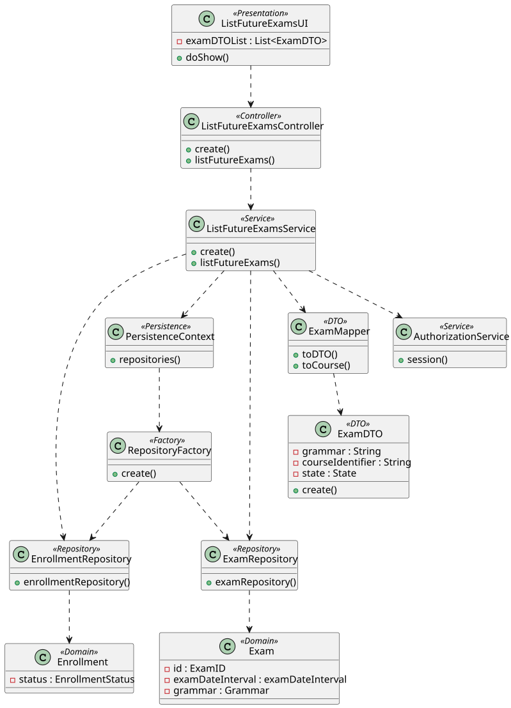
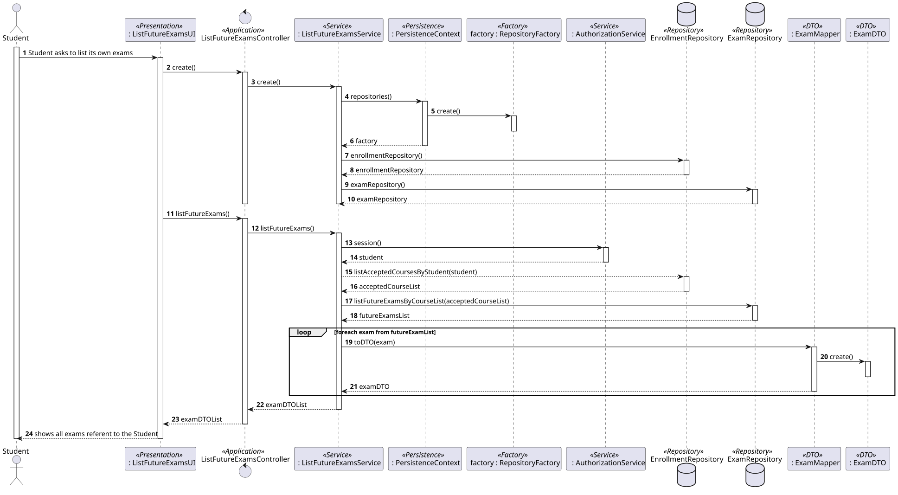

# US 2002 - As Student, I want to view a list of my future exams

## 1. Context

It is the first time the task is assigned to be developed.
This US allows every user to view all of he's exams

## 2. Requirements

**Main actor**

* Student

**Interested actors (and why)**

* Student: wants to list its own future exams

**Preconditions**

* There needs to be future exams referent to the Student

**Postconditions**

* All future exams of the Student need to be listed

**Main scenario**
1. Student asks to list its own exams
2. System shows all exams referent to the Student

**Other scenarios**

**a.** The system doesn't have any future exams for the student to be listed
1. Student asks to list its own exams
2. System shows informs that there are no future exams to be listed

**Special requirements**

N/A

## 3. Analysis

Relevant DM excerpt


## 4. Design
### 4.1 Rationale

|                                                  Main Scenario                                                   |                                                                                                                                                                             Question: which class...                                                                                                                                                                              |                                                                                              Answer                                                                                              |                                                                                                                                                                                                                                                Pattern (with justification)                                                                                                                                                                                                                                                 |
|:----------------------------------------------------------------------------------------------------------------:|:---------------------------------------------------------------------------------------------------------------------------------------------------------------------------------------------------------------------------------------------------------------------------------------------------------------------------------------------------------------------------------:|:------------------------------------------------------------------------------------------------------------------------------------------------------------------------------------------------:|:---------------------------------------------------------------------------------------------------------------------------------------------------------------------------------------------------------------------------------------------------------------------------------------------------------------------------------------------------------------------------------------------------------------------------------------------------------------------------------------------------------------------------:|
|                                      1. Student asks to list its own exams                                       |                                                                                                                        <p>A. Interacts with the Manager?</p><p>B. Coordinates the Use Case?</p> <p>C. Interacts with the Domain and Persistence Layer</p>                                                                                                                         |                                                <p> A. ListFutureExamsUI</p><p> B. ListFutureExamsController</p><p>C. ListFutureExamsService </p>                                                 |                                                                                              <p> A. Pure Fabrication - Class that doesn't exist in the domain but is necessary for the functionality of the system </p> <p> B. Controller - Responsible for handling system events  </p><p> C. Service - Class responsible for handling the domain layer and the persistence layer according with the controller requests</p>                                                                                               |
|                                2. System shows all exams referent to the Student                                 | <p>A. Knows which user is requesting the event? </p>  <p> B. Has all the exams persisted? </p> <p> C. Has all the enrollments persisted? </p> <p> D. Creates an instance of the repository? </p> <p> E. Creates an instance of the factory? </p> <p> F. Contains the data of an exam so it can be moved between layers?</p> <p> G. Transforms an Exam into DTO and vice-versa</p> | <p> A. AuthorizationService </p> <p> B. ExamRepository </p><p> C. EnrollmentRepository</p> <p> D. RepositoryFactory</p>  <p> E. PersistenceContext</p> <p> F. ExamDTO </p> <p> G. ExamMapper</p> | <p> A. Information Expert - Class has the necessary information to know its own state</p> <p> B. Repository - Has all the information of all exams persisted</p> <p> C. Repository - Has all the information of all enrollments persisted</p>  <p> <p> D. Factory - Responsible for the creation of the repositories</p> <p> E. ??????????</p> <p> F. DTO - Class that transports the necessary data between layers</p> <p> G. Mapper-DTO - Class responsible for transforming Domain Entities into DTOs and vice-versa</p> |

### 4.2. Class Diagram



### 4.3. Sequence Diagram

### 4.4. Tests

**Test 1:** *Verifies if all future exams are listed.*

```
Still Empty
````
**Test 2:** *Verifies if no future exams are listed when they don't have any.*
```
Still Empty
```

*In this section the team should present, if necessary, some evidencies that the implementation is according to the design. It should also describe and explain other important artifacts necessary to fully understand the implementation like, for instance, configuration files.*

## 5. Implementation
*It is also a best practice to include a listing (with a brief summary) of the major commits regarding this requirement.*

## 6. Integration/Demonstration

*In this section the team should describe the efforts realized in order to integrate this functionality with the other parts/components of the system*

*It is also important to explain any scripts or instructions required to execute an demonstrate this functionality*

## 7. Observations

*This section should be used to include any content that does not fit any of the previous sections.*

*The team should present here, for instance, a critical prespective on the developed work including the analysis of alternative solutioons or related works*

*The team should include in this section statements/references regarding third party works that were used in the development this work.*