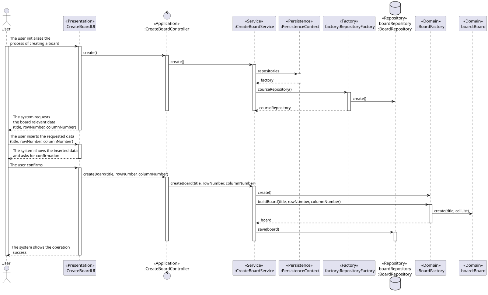

US3002: As User, I want to create a board.
=======================================

# 1. Context #
**US3002**: In this US the courses will be created that is relevant to **US3001** and **US3003**.

# 2 - Requirements #
**1. Acceptance Criteria**
- The created board must be persisted.

**2. Pre conditions**
- The communication infrastructure for the Shared Boards must be implemented.

**3.Main scenario**
1. User select the option to create a board.
2. System asks for board relevant data.
3. User introduces the data.
4. System verifies if the data is valid and informs the result of the saving operation.

**4. Alternative Flow**

# 2 - Analysis #
**1. Actor:** User.

**3.Client Clarifications**
- No clarification were given regarding this US so far.

**Interested actors**
- Every actor because any of them can be a participant of the board.

**Related US**
- US3001: The infrastructure must be implemented to create a functional board.
- US3003: We can only do the experimental testing with boards created.

**4.Relevant business aspects**
* The board can be utilized by any user.
* The board as an owner.

# 3. Design

## 3.1. System Diagram



# 4. Tests

**Test 1:** **
```
@Test
public void test() {
	
}
```

**Test 2:** **

```
@Test
public void test() {

}
```
