# US 2004 - As Student, I want to take an exam

## 1. Context

It is the first time the task is assigned to be developed.
This User story will allow students to take an exam and receive feedback and the result.

## 2. Requirements

**Main actor**

* Student

**Interested actors (and why)**

* Student - wants to take exam, see list of grades
* Teacher - wants to see list of grades from their courses

**Pre conditions**
* The student must be enrolled in a course where there is an exam available to take

**Post conditions**

* Result and feedback should both be printed on the screen and only the result should be persisted 

**Main scenario**

1. Student selects option to take an exam
2. System shows available exams for student to take
3. Student chooses exam
4. System shows exam specification and asks for txt file with the resolution
5. Student inserts file path
6. System asks for confirmation
7. Student confirms
8. System informs operation success

**Other scenarios**

**2.a.** The system verifies that there are no exams available
1. The system notifies that this problem has occurred
2. The use case terminates

**7.a.** The student doesn't confirm
1. The system requests a new file path
2. The use case returns to 5.

**8.a.** The system verifies that the resolution isn't in the required format
1. The system notifies that this problem has occurred
2. The use case terminates

**Special requirements**
The feedback and grade of the exam should be automatically calculated by a parser based on the grammar defined for exams structure.

## 3. Analysis

Relevant DM excerpt

## 4. Design

### 4.1. Rational

### 4.2 Sequence Diagram

### 4.3. Tests

## 5. Implementation

## 6. Observations
