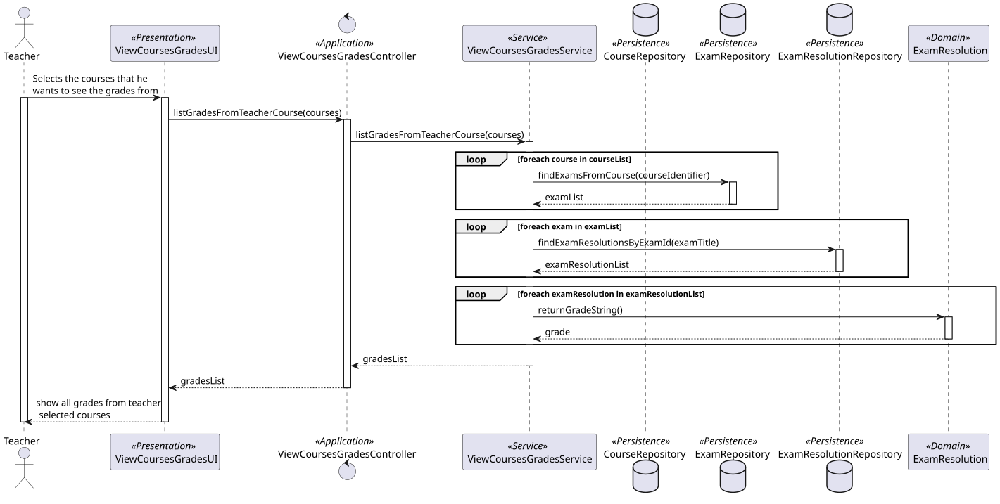

US2006: As Teacher, I want to view a list of the grades of exams of my courses.
=======================================

# 1. Context #
**US2006**: In this US the grades of exam of a teacher courses will be shown to him.

# 2. Requirements #
**1. Acceptance Criteria**
- All the grades of the teacher courses must be displayed on his screen.

**2. Pre conditions**
- There must be exams to be solved.
- The grading process must be implemented.
- The grades need to exist.

**3.Main scenario**
1. Teacher selects the option to view a list of the grades of exams of my courses.
2. System shows the grades.

# 3. Analysis #
**1. Actor:** Teacher.

**2.Client Clarifications**
- No clarification were given regarding this US so far.

**3.System Specification Document Clarifications**

- *3.1 Functional Requirements*
  - FRE06 - List Course Grades The system displays the grades of a class (to a teacher of
  that course) 
  
- *3.2 Documentation excerpts*
  - N/A

**4.Interested actors**
- Teacher.

**5.Related US**
- US2001: There must be an exam created.
- US2004: The students must be able to take an exam to generate grades.

**6.Relevant business aspects**
* The grades are the only way to evaluate a student.
* The grades are generated after a student takes an exam automatically.

# 4. Design

## 4.1. System Diagram



# 5. Tests

**Test 1:** **
```
    @Test
    public void test(){
        
    }
```

**Test 2:** **

```
    @Test
    public void test(){
        
    }
```


    

    

    

    
