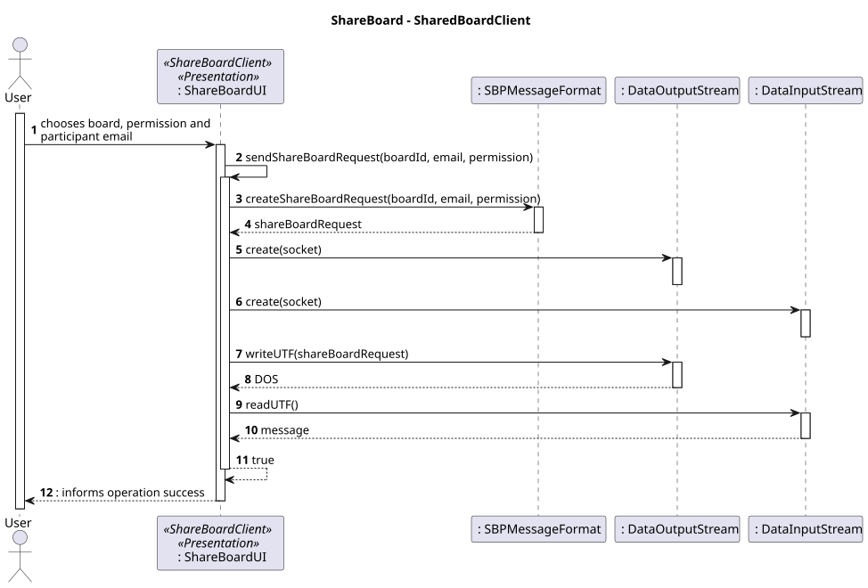
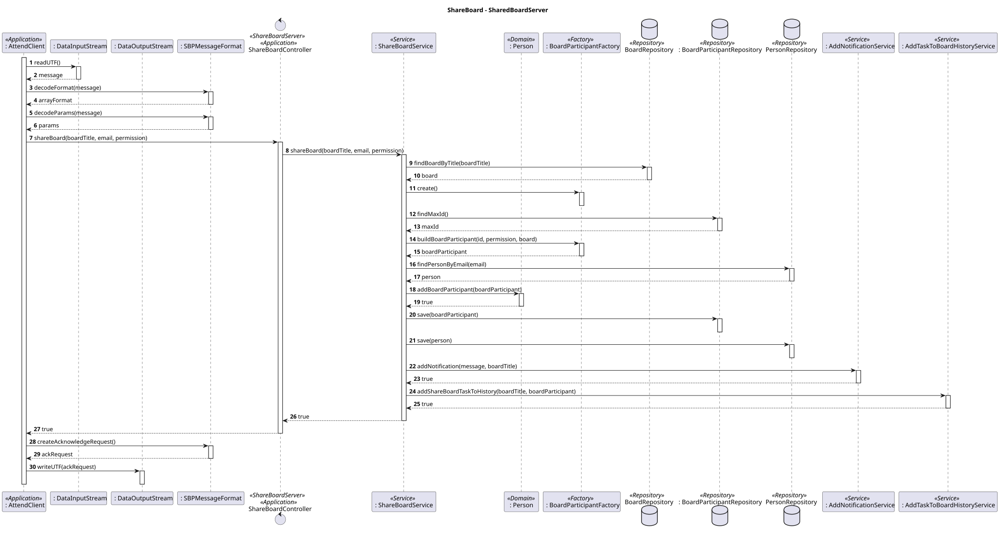

# US3004 - As User, I want to share a board

## 1. Context

It is the first time the task is assigned to be developed.
In this US it will be added in the board client app the option to add participants to your board.

## 2. Requirements
* FRB02 - Share Board A user shares a board it owns with other users
* NFR13 - Design and Implement Shared Board Synchronization This functional
  part of the system has very specific technical requirements, particularly some concerns
  about synchronization problems. In fact, several clients will try to concurrently update
  boards. As such, the solution design and implementation must be based on threads,
  condition variables and mutexes. Specific requirements will be provided in SCOMP

## 2. Analysis

**Main actor**

* Board Owner

**Interested actors (and why)**

* Board Owner: wants to add participant in his/her board
* Board Participant : will have access to a new board

**Preconditions**

* The user needs to own a board

**Postconditions**

* The new participant will be persisted and with the right permissions

**Main Scenario**
1. Board owner chooses the board, inserts the email of the new participant and its permissions
2. System informs operation success

### Relevant questions to the Client

**Question**

Dear client,

As I read all the requirements within this User Story, I have this question:
--Only the owner of a board is able to see its updates.

As I'm sharing the board, I have to do which of these?
--give permissions to the users to Write on it immediately

--only share it with Read permissions and afterwards have the possibility to give the user write permissions

--only share it with Read permissions and lock those permissions as Read

-After sharing the board with someone, should it be considered an update to be listed on User Story 3005?

**Answer**

Hello.

When a user shares a board he/she must specify the users and, for each user, if the access is read or write. I think it makes sense to notify current users of a board when some update is done regarding access to the board.

Regards.


### Relevant Domain Excerpt


## 3. Design
### 3.1 Rationale

|                                         Main Scenario                                          |                                                          Question: which class...                                                           |                                                      Answer                                                      |                                                                                                                                                   Pattern (with justification)                                                                                                                                                   |
|:----------------------------------------------------------------------------------------------:|:-------------------------------------------------------------------------------------------------------------------------------------------:|:----------------------------------------------------------------------------------------------------------------:|:--------------------------------------------------------------------------------------------------------------------------------------------------------------------------------------------------------------------------------------------------------------------------------------------------------------------------------:|
| 1. Board owner chooses the board, inserts the email of the new participant and its permissions |   <p>A. Interacts with the Board Owner?</p><p>B. Coordinates the Use Case?</p> <p>C. Interacts with the Domain and Persistence Layer</p>    |                <p> A. ShareBoardUI</p><p> B. ShareBoardController</p><p>C. ShareBoardService </p>                | <p> A. Pure Fabrication - Class that doesn't exist in the domain but is necessary for the functionality of the system </p> <p> B. Controller - Responsible for handling system events  </p><p> C. Service - Class responsible for handling the domain layer and the persistence layer according with the controller requests</p> |
|                              2. System informs operation success                               | <p> A. Will persist the BoardParticipant?</p> <p> B. Creates the object BoardParticipant</p> <p> C. Has a list of BoardParticipant</p> <p>  | <p> A. BoardParticipantRepository and PersonRepository</p> <p> B. BoardParticipantFactory</p> <p> C. Person </p> |                                      <p> A. Repository - Has all the information of boardParticipants persisted </p>  <p> B. Factory - Interface that allows the creation of an instance of a given class <p> C. Information Expert - Class has the necessary information about itself</p>                                       |

### 3.2. Sequence Diagram



### 3.3. Tests

**Test 1:** ** Verifies if the boardParticipant was created with the permission to write and read
````
````
**Test 2:** ** Verifies if the boardParticipant was created with the permission to read
````
````
## 4. Implementation
Here are some samples of the implementation:
A resume of the commits for the implementation :
## 5. Observations
N/A