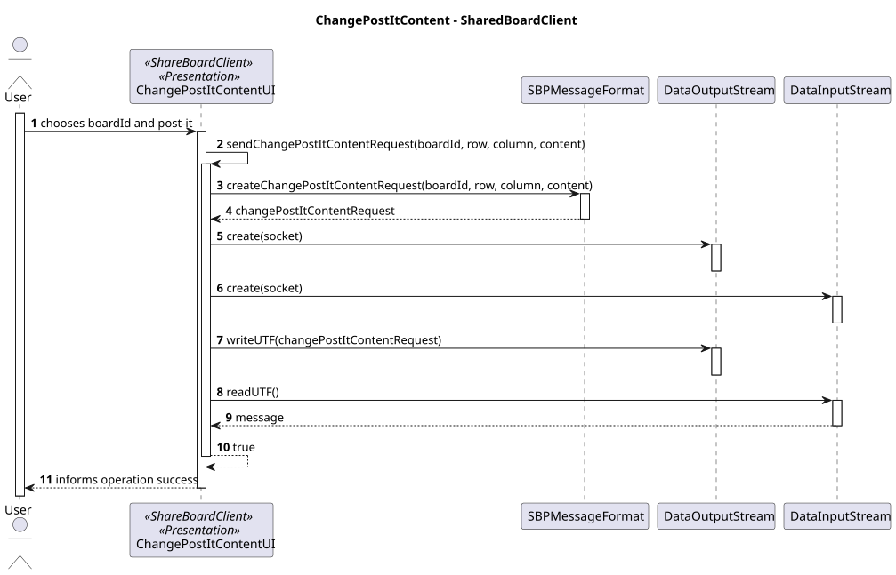
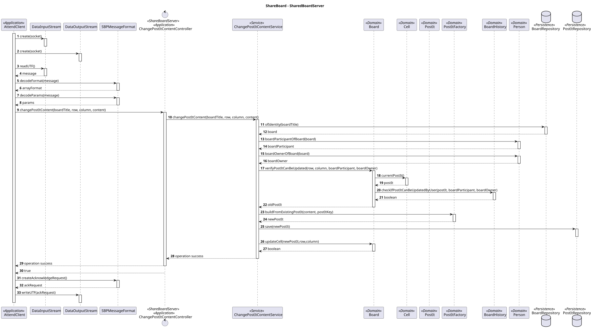

# US 3007 - As User, I want to change a post-it

## 1. Context

It is the first time the task is assigned to be developed.
This User story will allow users to change/update a post-it's content.

## 2. Requirements

**Main actor**

* Board Participant

**Interested actors (and why)**

* Board Participant - wants to update post-it, and view, in real-time, the updates in the shared boards

**Pre conditions**
* The board participant must have read/write permissions in a board and must have created a post-it in that board

**Post conditions**

* Changes should be persisted in the database and be observable in thr real-time board view

**This US can be divided into two Use Cases:**

1. Change post-it content
2. Change post-it position

**Change post-it content main scenario**

1. Board participant selects option to change post-it content
2. System shows available post-its for board participant to change
3. Board participant chooses post-it
4. System ask for new post-it content
5. Board participant inserts new content
6. System asks for confirmation
7. Board participant confirms
8. System informs operation success

**Change post-it content other scenarios**

**2.a.** The system verifies that there are no post-its available
1. The system notifies that this problem has occurred
2. The use case terminates

**7.a.** The Board participant doesn't confirm
1. The use case terminates

**Special requirements**
N/A

**Change post-it position main scenario**

1. Board participant selects option to change post-it position
2. System shows available post-its for board participant to change
3. Board participant chooses post-it
4. System ask for new post-it position
5. Board participant inserts new position
6. System asks for confirmation
7. Board participant confirms
8. System informs operation success

**Change post-it position other scenarios**

**2.a.** The system verifies that there are no post-its available
1. The system notifies that this problem has occurred
2. The use case terminates

**7.a.** The Board participant doesn't confirm
1. The use case terminates

**Special requirements**
N/A

## 3. Analysis

Relevant DM excerpt

**Client clarification:**  
N/A

## 4. Design

### Change post-it content
### 4.1. Rational
|                         Main Scenario                         |                   Question: Which class...                    |            Answer             |                                                              Pattern                                                               |
|:-------------------------------------------------------------:|:-------------------------------------------------------------:|:-----------------------------:|:----------------------------------------------------------------------------------------------------------------------------------:|
| 1. Board participant selects option to change post-it content |                  ...interacts with the user                   |     ChangePostItContentUI     |                                                          Pure Fabrication                                                          |
|                                                               |                  ...coordinates the use case                  | ChangePostItContentController |                                                             Controller                                                             |
|                                                               |              ...interacts with the domain layer               |  ChangePostItContentService   |             Controller-service - hides the complexity of the use case from the controller class, lowering its coupling             |
|                             (...)                             |                                                               |                               |                                                                                                                                    |
|             4. System ask for new post-it content             |                                                               |                               |                                                                                                                                    |
|           5. Board participant inserts new content            |                                                               |                               |                                                                                                                                    |
|                6. System asks for confirmation                |                                                               |                               |                                                                                                                                    |
|                 7. Board participant confirms                 |                  ...stores the inserted data                  |            PostIt             |                                         Information Expert - the class knows its own data                                          |
|                                                               | ...creates the instance responsible for persisting Enrollment |       RepositoryFactory       | Abstract Factory - Interface responsible for creating a Factory of related Objects without explicitly specifying the intend Class; |
|                                                               |                ...persists the created object                 |       PostItRepository        |            Repository -  hide the details of persisting and reconstructing an object while keeping the domain language             |
|              8. System informs operation success              |                                                               |                               |                                                                                                                                    |

Summary of needed classes :
* ChangePostItContentUI
* ChangePostItContentController
* ChangePostItContentService
* PostIt
* PostItRepository

### 4.2 Sequence Diagram

### 4.3. Tests
N/A

### Change post-it position
### 4.1. Rational

## 5. Implementation
Here are some samples of the implementation:

## 6. Observations
N/A