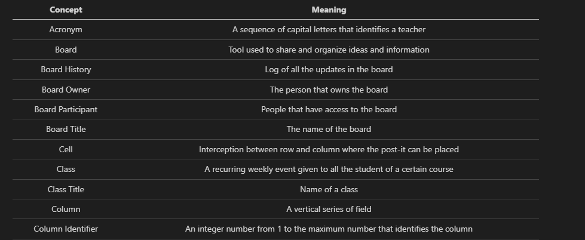

# US G001 - As Project Manager, I want the team to follow the technical constraints and concerns of the project

## 1. Context

As a team, we need to follow the constraints and concerns of the project so that we can achieve its goals.

## 2. Requirements

The solution should be implemented using Java as the main language. Other languages can be used in accordance with more specific requirements.
Project documentation should be always available on the project repository ("docs" folder, markdown format) and, when applicable, in accordance with the UML notation. The development process of every US (e.g.: analysis, design, testing, etc.) must be reported (as part of the documentation).
The team should develop a relevant set of automated tests for every US / Class / Method. The team should aim to adopt a test-driven development approach.

## 3. Analysis

We're analysing the constraints of the project and got to know better how the project was. 

## 4. Design

### 4.1. Realization

On every US we will follow every constraint that the project asks, such as documentation of every US, the use of mainly the Java language and the creation of tests for every US.

## 5. Integration/Demonstration

Examples of documentation:

## 7. Observations

There aren't any other additional observations to be made for this US