# US G002 - As Project Manager, I want the team to elaborate a Domain Model using DDD.

## 1. Context

In this US we were asked to develop a Domain Model which is essential for the project design.

## 2. Requirements

A domain model must be created and maintained updated. The domain model should be included in the technical documentation of the repository.

## 3. Analysis
### Domain Model

## 4. Design

*In this sections, the team should present the solution design that was adopted to solve the requirement. This should include, at least, a diagram of the realization of the functionality (e.g., sequence diagram), a class diagram (presenting the classes that support the functionality), the identification and rational behind the applied design patterns and the specification of the main tests used to validade the functionality.*

### 4.1. Realization

### 4.2. Applied Patterns

## 5. Observations

*This section should be used to include any content that does not fit any of the previous sections.*

*The team should present here, for instance, a critical prespective on the developed work including the analysis of alternative solutioons or related works*

*The team should include in this section statements/references regarding third party works that were used in the development this work.* 
